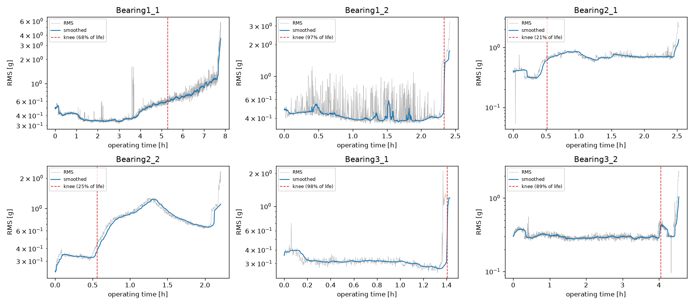
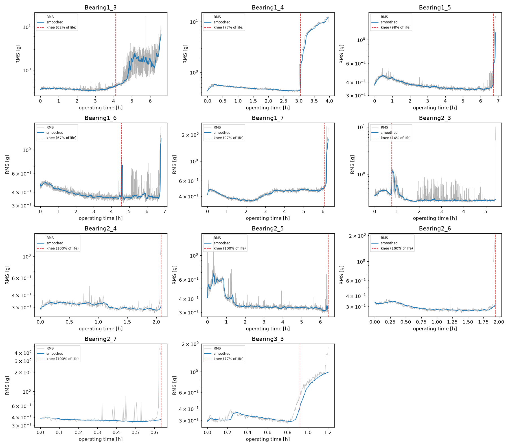
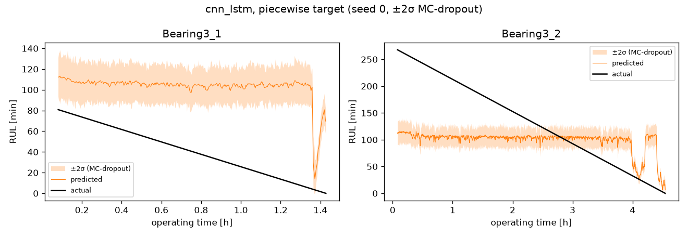
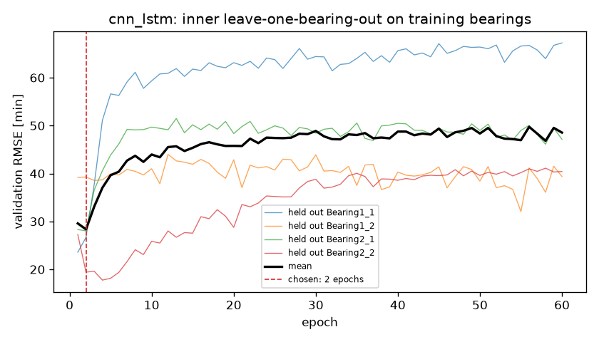
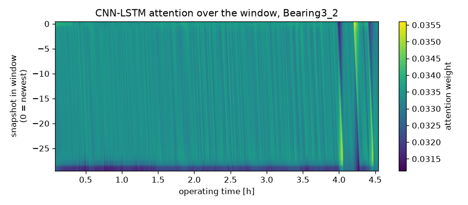
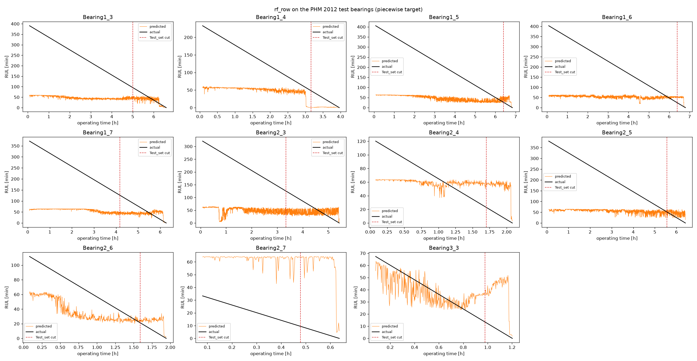
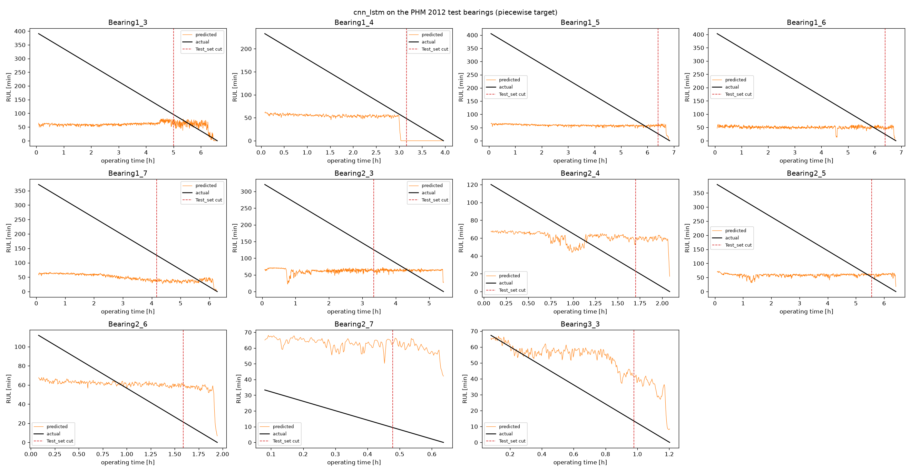

# Bearing RUL Prediction on FEMTO-ST / PHM 2012: Progress Report

Status as of 29 October 2026. Every number in this report was produced by the code in this
repository; section 11 has the commands to reproduce it.

## 1. Summary

**What was done.** The full pipeline from raw vibration files to RUL predictions is built and
tested: loader, 20 features per snapshot, health indicator and RUL labels, sliding windows,
classical baselines (Ridge, Random Forest), five deep models (MLP, LSTM, GRU, 1D-CNN and a
1D-CNN-LSTM with an attention variant and MC-dropout uncertainty), the official PHM 2012 test-set
benchmark, and a maintenance-warning prototype. 38 automated tests cover the data quirks, the
feature maths, the labels, the windowing, the training code, the benchmark scoring and the
warning rule.

The baselines and the CNN-LSTM were evaluated twice:
- **Validation split:** train on Bearing1_1, 1_2, 2_1, 2_2; test on Bearing3_1, 3_2.
- **Official PHM 2012 protocol:** train on all 6 learning bearings; test on the 11 test bearings.

The MLP, LSTM, GRU and 1D-CNN (architectures from the group's original Keras notebooks, ported
to the shared PyTorch pipeline) were run on the official protocol only.

**Main findings**

1. **The CNN-LSTM effectively ties the best baseline.** On the validation split its mean
   absolute error is 63.2 ± 0.2 min, against 63.6 min for the Random Forest. Attention makes it
   slightly worse (65.2 min).
2. **On the official test set, almost no model beats a constant "predict the average"
   baseline.** The best official score (Random Forest, 0.257) is a lucky single snapshot: scored
   at any point in the 5 minutes before the official cut, the same model gets 0.065 to 0.257,
   averaging 0.161. The constant baseline averages 0.156. The one exception is the plain
   1D-CNN, which averages 0.201 (0.180 at the cut), but it also has the worst full-curve error
   and predicts early more often, so part of that gain may be a bias toward low predictions
   (section 6.2). The LSTM, GRU, MLP and CNN-LSTM all score below the constant.
3. **The cause is in the data: most bearings fail abruptly.** 6 of the 11 test bearings show
   no degradation at their cut point, yet their true remaining life ranges from 10 to 126 min.
   Vibration features cannot tell these bearings apart.
4. **Deep models overfit to the training bearings within 1–2 epochs.** Error on a held-out
   training bearing is lowest after 1–2 epochs and rises with any further training. All six
   deep models (CNN-LSTM, its attention variant, LSTM, GRU, MLP, 1D-CNN) chose 1 epoch on the
   benchmark, except the 1D-CNN, which chose 2.
5. **MC-dropout uncertainty is badly overconfident.** The ±2σ band contains the true RUL only
   11–12% of the time; a calibrated band would contain it about 95% of the time.
6. **A simple warning rule gives useful warning for 5 of 11 test bearings.** The rule raises an
   alarm when predicted RUL stays below 10 min; "useful" means 2–60 min before failure. The
   median warning comes only 2–7 min before failure, depending on the model.
7. **Several parts of the original plan needed correcting** (section 8), and the ground truth
   for one test bearing (Bearing1_4) is doubtful (section 2.4).

## 2. Data

### 2.1 Source and structure

The FEMTO-ST download page named in the brief is offline. The same data is the IEEE PHM 2012
Prognostic Data Challenge release, mirrored at
[github.com/Lucky-Loek/ieee-phm-2012-data-challenge-dataset](https://github.com/Lucky-Loek/ieee-phm-2012-data-challenge-dataset).

17 bearings were run to failure on the PRONOSTIA rig under three operating conditions:
1800 rpm / 4000 N, 1650 rpm / 4200 N and 1500 rpm / 5000 N. Every 10 s the rig recorded a
0.1 s snapshot of horizontal and vertical acceleration at 25.6 kHz, which is 2560 samples per
channel.

| Folder | Bearings | Used for |
|---|---|---|
| Learning_set | 1_1, 1_2, 2_1, 2_2, 3_1, 3_2 | training (complete runs) |
| Test_set | 1_3–1_7, 2_3–2_7, 3_3 | model input (runs cut off mid-life) |
| Full_Test_Set | the same 11 bearings | ground truth only, never trained on |

Lifetimes range from 38 min (Bearing2_7) to 7.8 h (Bearing1_1), a 12× spread.

### 2.2 Verification

- **File counts:** all 17 bearings match the published counts exactly (Bearing1_1, for example,
  has 2803 snapshots = 28,030 s). Files are numbered without gaps, and the loader asserts that
  every snapshot has shape (2560, 6).
- **Sampling interval:** raw timestamps confirm that snapshots are exactly 10 s apart in every
  bearing, so snapshot index × 10 s is operating time.
- **Test_set is an exact prefix of Full_Test_Set.** Git blob hashes match for 12,820 of the
  13,959 Test_set files. The other 1,139 are all Bearing1_4's, and they differ only in
  formatting (`;` as delimiter, `e+005` vs `e+05` exponents); spot-checked files parse to
  identical values. The
  model input for a test bearing is therefore the first len(Test_set) rows of its
  Full_Test_Set features, and Test_set never needs downloading.

### 2.3 Format quirks handled in the loader

| Quirk | What goes wrong if ignored | Handling |
|---|---|---|
| Bearing1_4 (Full_Test_Set) uses `;` | file silently parsed as a single column | delimiter detected per file |
| Microsecond column in scientific notation | integer parsing fails | everything parsed as float |
| No header rows | first data row lost | `header=None` |
| No temperature files for 2_2, 3_2, 1_3, 2_3, 2_6 | crash when loading temperature | temperature not used as a feature |
| DC offset above 5% of signal power in 8 of 5,606 Bearing1_1 channel-snapshots (max 39%) | offset lands in the lowest frequency band | spectrum computed on the mean-removed signal |

### 2.4 Data anomalies that affect evaluation

- **Bearing1_4's ground truth is doubtful.** Its RMS jumps about 25× at 3.05 h, before its
  Test_set cut at 3.16 h. The recording then continues for another 48 min at 5–12 g RMS, and no
  learning bearing runs anywhere near that long at such levels. The RUL at the cut taken from
  the recording is 2890 s. Published tables have reportedly used 339 s, which we could not
  verify. The benchmark reports scores both with and without this bearing.
- **The 20 g stopping rule cannot be located in the data.** Single snapshots exceed 20 g long
  before the end (Bearing1_1 at snapshot 1299 of 2803, Bearing1_2 at 127 of 871), and four test
  bearings never reach 20 g at all. The end of each recording is used as the failure point.

## 3. Pipeline

| Stage | Module | What it does |
|---|---|---|
| 1 Load | [`src/loader.py`](../src/loader.py) | raw CSV files → array of shape (snapshots, 2560, 2) |
| 2 Features | [`src/features.py`](../src/features.py) | 20 features per snapshot → `data/features/<Bearing>.csv` (the team contract) |
| 3 Labels | [`src/labels.py`](../src/labels.py) | knee point, health indicator, linear and piecewise RUL |
| 4 Windows | [`src/windows.py`](../src/windows.py) | 30-snapshot windows, scaling, leak-free train/test split |
| 5 Models | [`src/models/`](../src/models/) | baselines, shared PyTorch training code, MLP, LSTM/GRU, 1D-CNN, CNN-LSTM |
| Evaluation | [`src/evaluate.py`](../src/evaluate.py), [`src/benchmark.py`](../src/benchmark.py) | metrics, plots, official test protocol |
| Decision | [`src/maintenance.py`](../src/maintenance.py) | RUL → maintenance warning, and its evaluation |

### 3.1 Features

Each channel (horizontal `_h`, vertical `_v`) gets:
- RMS
- kurtosis (Pearson definition, 3 for Gaussian noise)
- skewness
- peak absolute value
- crest factor (peak / RMS)
- peak-to-peak
- power in four equal frequency bands covering 0–12.8 kHz (3.2 kHz each)

The band powers come from the one-sided power spectrum of the mean-removed snapshot and sum
exactly to the signal variance; that check passes to within 10⁻¹². Feature files for all 17
bearings take 4.8 MB and are committed, so only one person needs the raw data.

### 3.2 Labels

- **Linear RUL:** row i of an N-snapshot run has RUL = N − 1 − i snapshots.
- **Knee (start of degradation):** a 5-min causal rolling median of the combined RMS,
  √((rms_h² + rms_v²)/2), must stay above mean + 3·std for 1 minute. The mean and std come from
  the raw RMS in minutes 5–15, which skips the run-in period.
- **Piecewise RUL:** linear RUL capped at one global value, the median post-knee life of the
  training bearings. The cap is 110 min when training on 4 bearings and 64 min when training on
  all 6.
- Models are always **evaluated against true linear RUL**, whichever target they were
  trained on.

### 3.3 Windows and leakage safeguards

- Each sample is 30 consecutive snapshots (5 min of operation), labelled with the RUL at its
  last snapshot.
- Magnitude features are log-transformed, because they span 2–3 orders of magnitude between
  healthy and failing, and then standardised.
- **Data is split by bearing, never by row.** The scaler and the RUL cap are fitted on training
  bearings only, and the split function refuses any bearing that appears on both sides.
- **The deep models' epoch count is chosen without touching the test bearings.** Each training
  bearing is held out in turn, and the epoch with the lowest average held-out error is used.
- Full_Test_Set is never used for training, scaling or tuning.

### 3.4 Models

| Model | Input | Configuration |
|---|---|---|
| Constant | none | always predicts the mean training target (the floor) |
| Ridge | last snapshot, or flattened window | α = 1, untuned |
| Random Forest | last snapshot, or flattened window | 200 trees, min leaf 5, 33% of features per split, untuned |
| MLP | 30 × 20 window, flattened | Linear 128 → 64 → 32 → 1, batch norm and dropout 0.2 |
| LSTM / GRU | 30 × 20 window | one recurrent layer (32) → dropout 0.1 → Linear 16 → 1 |
| 1D-CNN | 30 × 20 window | Conv1d 20→32→64 (kernel 3, batch norm), max-pool 2 → Linear 32 → 16 → 1; dropout 0.2 |
| CNN-LSTM | 30 × 20 window | Conv1d 20→32→64 (kernel 3) → LSTM (64) → linear; dropout 0.2; 41.5k parameters |
| CNN-LSTM + attention | 30 × 20 window | as above, with learned attention pooling over the 30 steps; 45.7k parameters |

The MLP, LSTM, GRU and 1D-CNN follow the layer layout of the group's original Keras notebooks.
Those notebooks trained with Huber loss, Adam and a validation split taken from the end of the
training array; here every deep model goes through the same shared code instead, so the numbers
are comparable with each other and with the baselines.

The deep models are trained with MSE on RUL / cap, AdamW (learning rate 10⁻³, weight decay
10⁻⁴), batch size 128 and gradient clipping at 1.0. The epoch count is searched up to 60 on the
validation split and up to 30 on the benchmark, and each final model is trained with 3 random
seeds. MC-dropout uses 50 stochastic forward passes.

## 4. Degradation analysis





| Bearing | Set | Life (min) | Knee (% of life) | Life after knee (min) | RUL at Test_set cut (min) | Degrading at cut |
|---|---|---|---|---|---|---|
| 1_1 | learning | 467 | 68% | 150.0 | | |
| 1_2 | learning | 145 | 97% | 5.0 | | |
| 2_1 | learning | 152 | 21% | 120.5 | | |
| 2_2 | learning | 133 | 25% | 99.0 | | |
| 3_1 | learning | 86 | 98% | 1.3 | | |
| 3_2 | learning | 273 | 89% | 29.5 | | |
| 1_3 | test | 396 | 62% | 148.5 | 95.5 | yes |
| 1_4 | test | 238 | 77% | 54.3 | 48.2 | yes (anomalous, section 2.4) |
| 1_5 | test | 411 | 98% | 6.3 | 26.8 | no |
| 1_6 | test | 408 | 67%* | 133.5 | 24.3 | yes* |
| 1_7 | test | 377 | 97% | 12.7 | 126.2 | no |
| 2_3 | test | 326 | 14%* | 279.8 | 125.5 | yes* |
| 2_4 | test | 125 | none | 0 | 23.2 | no |
| 2_5 | test | 385 | none | 0 | 51.5 | no |
| 2_6 | test | 117 | none | 0 | 21.5 | no |
| 2_7 | test | 38 | none | 0 | 9.7 | no |
| 3_3 | test | 72 | 77% | 16.8 | 13.7 | yes |

\* The knees of 1_6 and 2_3 come from short vibration bursts after which RMS returns to
baseline; visually, both bearings look healthy at their cut.

What the curves show:
- **Two failure modes.** Some bearings degrade gradually, with RMS rising over hours (1_1, 1_3,
  3_3, and the level shifts of 2_1 and 2_2). Others fail abruptly: RMS stays flat until the
  last minutes. **Abrupt failure is the majority:** 9 of 17 bearings have their knee at ≥ 89% of
  life or no detectable knee at all.
- Several bearings have **run-in transients** in their first 0.15–1.5 h.
- **Known limitation:** Bearing1_1's long run-in inflates its baseline, so its detected knee
  (68% of life) comes later than the visible rise (about 45%).

## 5. Experiment 1: validation split

The models train on 1_1, 1_2, 2_1, 2_2 (5,266 windows) and are tested on 3_1, 3_2 (2,094
windows). The test bearings ran under an operating condition that none of the training bearings
did, which makes this the hardest kind of split. Piecewise cap: 110 min.

### 5.1 Results

Error in minutes against true RUL. Deep models: mean ± std over 3 seeds.

| Model | Input | Target | 3_1 MAE | 3_2 MAE | Pooled MAE | Pooled RMSE | Pooled R² |
|---|---|---|---|---|---|---|---|
| Ridge | row | linear | 274.7 | 159.7 | 186.4 | 206.6 | −5.80 |
| Ridge | window | linear | 270.8 | 156.0 | 182.7 | 203.5 | −5.60 |
| Random Forest | row | linear | 135.9 | 78.8 | 92.1 | 109.0 | −0.89 |
| Random Forest | window | linear | 87.7 | 67.2 | 72.0 | 87.6 | −0.22 |
| Ridge | row | piecewise | 82.4 | 61.5 | 66.3 | 75.4 | 0.10 |
| Ridge | window | piecewise | 68.7 | 71.9 | 71.2 | 87.9 | −0.23 |
| Random Forest | row | piecewise | 61.4 | 65.9 | 64.9 | 76.2 | 0.08 |
| Random Forest | window | piecewise | 60.8 | 64.4 | 63.6 | 75.3 | 0.10 |
| **CNN-LSTM** | window | piecewise | 60.4 ± 2.2 | 64.0 ± 0.6 | **63.2 ± 0.2** | 75.3 ± 0.5 | 0.10 |
| CNN-LSTM + attention | window | piecewise | 68.2 ± 3.5 | 64.3 ± 1.2 | 65.2 ± 0.1 | 76.1 ± 0.6 | 0.08 |

- **The piecewise target beats the linear one for every model.** Ridge on single rows, for
  example, improves from 186 to 66 min.
- **The CNN-LSTM and the best Random Forest are effectively tied.** The CNN-LSTM is ahead by
  0.4 min (0.6%), which is negligible in practice. The Random Forest was only run with one seed,
  so its own run-to-run spread is unknown.
- **Per-bearing R² is strongly negative for 3_1 for every model** (−6 to −140). Its true RUL
  only spans 81 minutes, so R² punishes any constant offset harshly. Pooled MAE is the more
  meaningful comparison.



Every model behaves the same way: it predicts close to the healthy-state level (about 105 min)
until vibration rises in the last minutes, then drops.

### 5.2 Choosing the number of epochs



Average error on the held-out training bearing:

| Epoch | 1 | 2 | 5 | 10 | 30 | 60 |
|---|---|---|---|---|---|---|
| CNN-LSTM error (min) | 29.6 | **28.3** | 39.6 | 44.0 | 48.9 | 48.5 |

The error is lowest after 2 epochs, or 1 for the attention variant, and rises after that.
Further training fits the training bearings, not bearings in general.

### 5.3 Uncertainty (MC-dropout)

| Model | Coverage of ±2σ band | Coverage, last 25% of life | Mean σ (min) |
|---|---|---|---|
| CNN-LSTM | 12.4% | 4.3% | 9.4 |
| CNN-LSTM + attention | 11.0% | 0.0% | 9.0 |

A calibrated ±2σ band would contain the true RUL about 95% of the time. Here the band is about
±19 min wide while the errors are around 60 min, so the uncertainty is far too confident.

### 5.4 Attention



All attention weights fall between 0.031 and 0.036, against 1/30 = 0.033 for perfectly even
weighting, so the attention layer is effectively plain averaging. That is consistent with the
model being trained for a single epoch. The faint diagonal streaks are vibration spikes moving
through the window as it slides.

### 5.5 Error by stage of life

MAE (min) per quarter of each bearing's life:

| Model | Bearing | 0–25% | 25–50% | 50–75% | 75–100% |
|---|---|---|---|---|---|
| CNN-LSTM | 3_1 | 35.4 | 52.2 | 71.4 | 83.6 |
| CNN-LSTM | 3_2 | 129.1 | 66.0 | 17.0 | 47.2 |
| Random Forest, window, piecewise | 3_1 | 34.3 | 51.0 | 74.2 | 77.8 |
| Random Forest, window, piecewise | 3_2 | 131.3 | 67.8 | 17.1 | 46.0 |

For Bearing3_1 the error *grows* toward failure: the prediction stays near the healthy level
while the true RUL runs down to zero. Errors late in life are mostly late predictions, the
dangerous direction.

## 6. Experiment 2: official PHM 2012 benchmark

**Protocol.** Models train on all 6 learning bearings (7,360 windows; cap 64 min) and predict
the full runs of all 11 test bearings (17,036 windows).

- **Official score:** one prediction per bearing, at the last window before its Test_set cut,
  scored with the PHM 2012 accuracy function and averaged over the 11 bearings. The function
  penalises late predictions (RUL overestimated) much more than early ones.
- **5-min mean score:** one snapshot per bearing is noisy, so the benchmark also averages the
  score over the official cut and each of the 30 snapshots before it.

### 6.1 Results

| Model | PHM score (official cut) | PHM score (5-min mean) | PHM score without 1_4 | Late predictions at cut | Full-curve MAE (min) |
|---|---|---|---|---|---|
| Constant | 0.107 | 0.156 | 0.099 | 73% | 124.8 |
| Ridge, row | 0.040 | 0.099 | 0.040 | 73% | 124.3 |
| Ridge, window | 0.086 | 0.074 | 0.091 | 73% | 124.0 |
| **Random Forest, row** | **0.257** | **0.161** | **0.280** | 45% | 125.5 |
| Random Forest, window | 0.111 | 0.115 | 0.119 | 36% | 128.9 |
| CNN-LSTM (3 seeds) | 0.069 ± 0.004 | 0.080 | 0.068 | 64% | 123.2 |
| CNN-LSTM + attention (3 seeds) | 0.072 ± 0.013 | 0.074 | 0.065 | 64% | 123.8 |
| LSTM (3 seeds) | 0.075 ± 0.032 | 0.070 | 0.069 | 61% | 123.0 |
| GRU (3 seeds) | 0.083 ± 0.014 | 0.098 | 0.068 | 64% | 125.2 |
| MLP (3 seeds) | 0.112 ± 0.043 | 0.113 | 0.119 | 61% | 127.2 |
| **1D-CNN (3 seeds)** | 0.180 ± 0.032 | **0.201** | 0.195 | 42% | 132.3 |

Predictions at the Test_set cut (seconds; deep models averaged over seeds):

| Bearing | Actual | Degrading at cut | Constant | RF row | RF window | CNN-LSTM | CNN-LSTM + attn | LSTM | GRU | MLP | 1D-CNN |
|---|---|---|---|---|---|---|---|---|---|---|---|
| 1_3 | 5730 | yes | 3248 | 2989 | 1992 | 3667 | 3580 | 1188 | 1613 | 2643 | 1841 |
| 1_4 | 2890 | yes | 3248 | 30 | 39 | 544 | 1288 | 969 | 1588 | 88 | 125 |
| 1_5 | 1610 | no | 3248 | 1608 | 1209 | 3354 | 3491 | 3513 | 3252 | 2489 | 1920 |
| 1_6 | 1460 | yes* | 3248 | 3165 | 2361 | 2923 | 2506 | 3425 | 2987 | 1783 | 1057 |
| 1_7 | 7570 | no | 3248 | 2935 | 2320 | 2083 | 1856 | 2662 | 2116 | 1652 | 1514 |
| 2_3 | 7530 | yes* | 3248 | 2993 | 1914 | 3979 | 4051 | 3898 | 3984 | 3548 | 2923 |
| 2_4 | 1390 | no | 3248 | 3212 | 3715 | 3250 | 3686 | 3642 | 3316 | 3169 | 2648 |
| 2_5 | 3090 | no | 3248 | 3251 | 1757 | 3633 | 3664 | 3658 | 3463 | 3272 | 2428 |
| 2_6 | 1290 | no | 3248 | 1243 | 804 | 3788 | 3857 | 3790 | 3777 | 2112 | 1163 |
| 2_7 | 580 | no | 3248 | 3834 | 3832 | 3695 | 3686 | 3733 | 3582 | 3063 | 3314 |
| 3_3 | 820 | yes | 3248 | 2221 | 1365 | 2544 | 2365 | 2532 | 2892 | 1773 | 1419 |





### 6.2 What the benchmark shows

- **The Random Forest's 0.257 is mostly two lucky hits.** On 1_5 it predicted 1608 s against an
  actual 1610 s (accuracy 1.00), and on 2_6 1243 s against 1290 s (accuracy 0.88). Together
  these supply two thirds of its total. Both bearings look healthy at the cut, where the model's
  predictions swing by tens of minutes from one snapshot to the next. Averaged over the last
  5 minutes, its score falls to 0.161, level with the constant's 0.156.
- **No model reliably separates the healthy-looking bearings.** For the six bearings that look
  healthy at the cut, the CNN-LSTM predicts 35–63 min every time, while the true RUL ranges from
  10 to 126 min. The 1D-CNN is closer on three of them (1_5, 2_5 and 2_6, within about 20%),
  but it still misses 1_7 by a factor of 5 (too low) and 2_7 by a factor of 5.7 (too high).
- **The 1D-CNN's lead is real in the table but should not be over-read.** It beats the
  constant on the 5-min mean (0.201 against 0.156) and has the lowest share of late predictions
  of the deep models (42%), yet its full-curve MAE is the worst of all models (132 min), because
  its predictions run lower than the others. The PHM score punishes late predictions much harder
  than early ones, so a model that simply predicts lower earns more. With 11 bearings, 3 seeds
  (std 0.032 at the cut) and no hyperparameter tuning, a 0.04 gap on the 5-min mean is a lead
  worth checking with leave-one-bearing-out evaluation, not a settled ranking.
- **Adding recurrence did not help here.** The LSTM, GRU and CNN-LSTM, all of which keep a
  hidden state across the window, score below the constant on the 5-min mean (0.070, 0.098 and
  0.080), while the MLP, which ignores time order, scores 0.113. A possible reason, not tested here, is
  that the useful signal is a level shift in vibration rather than a temporal pattern, so a model
  that sees the whole window at once has nothing extra to gain from remembering its order.
- **Bearing1_4 is already visibly failing at its cut,** so every model predicts close to zero,
  against a recorded 2890 s.
- **Many predictions are late:** depending on the model, 36–73% of the cut-point predictions
  overestimate RUL, which is the error direction the score punishes hardest.
- **Full-curve MAE is about 123–129 min for every model, constant included.** It is dominated by
  the early life of the long test bearings, where the true RUL is up to 410 min but predictions
  are bounded near the 64-min cap. This metric cannot rank the models.
- **The brief expects large errors early and small errors near failure.** That holds for the
  long test bearings (CNN-LSTM error falls from about 150–300 min in the first quarter of life to
  16–28 min in the last). It fails for the short ones (2_4, 2_6, 2_7, 3_3), where error *rises*
  toward failure; on 2_7, for example, it goes from 34 to 55 min.

## 7. Maintenance decision prototype

**Rule:** raise an alarm when predicted RUL stays below a threshold T for 3 consecutive
snapshots (30 s). Each test bearing's full recording is replayed as if live, and the first
alarm is classified:

- **useful:** 2–60 min before failure
- **too late:** under 2 min before failure
- **early:** more than 60 min before failure (the bearing would be replaced too soon)
- **missed:** no alarm before failure

Results at T = 10 min:

| Model | Useful | Too late | Missed | Early | Median warning before failure |
|---|---|---|---|---|---|
| Random Forest, row | 5 | 4 | 1 | 1 | 3.6 min |
| Random Forest, window | 4 | 4 | 1 | 2 | 7.1 min |
| CNN-LSTM | 5 | 2 | 4 | 0 | 2.2 min |
| Constant | 0 | 0 | 11 | 0 | none |

The threshold trades misses for early alarms. For the Random Forest (row), T = 5 min gives
5 useful alarms and 4 misses, while T = 30 min gives 5 useful, no misses and 4 early alarms
(median warning 40 min ahead).

- **Useful warnings come from bearings that visibly degrade before failing:** 1_3 (19 min
  ahead), 1_4 (56 min), 1_7 (7 min), 1_6 (4 min), 1_5 (3 min), all from the Random Forest at
  T = 10.
- **Abrupt failures leave almost no warning:** 0–1.5 min for 2_4, 2_6, 2_7 and 3_3.
- **One early alarm comes from a transient:** a short vibration burst on 2_3 at 0.8 h triggers
  an alarm 281 min before failure.
- **In practice,** these models work as late-stage alarms, not long-range forecasts.

## 8. Corrections to the original plan

| The plan said | What the data showed | What we do instead |
|---|---|---|
| Knee where smoothed RMS exceeds mean + 3·std of the *smoothed* early baseline | The smoothed baseline's std is tiny, so ordinary noise crosses it (Bearing1_2 "knee" at 17% of life) | Baseline stats from raw RMS, skipping 5-min run-in, with 1-min persistence |
| Cap piecewise RUL at each bearing's own knee | Identical-looking healthy inputs get targets of ~900 vs ~5 snapshots (1_1 vs 3_1), which no model can learn | One global cap: median post-knee life of the training bearings |
| Download both Test_set and Full_Test_Set | Test_set is an exact prefix of Full_Test_Set | Download Full_Test_Set only |
| Use the PHM score on RUL generally | It is undefined at RUL = 0 and explodes near failure; a single snapshot per bearing is noisy | Score only at cut points; report the 5-min mean alongside the official score |
| Failure = vibration above 20 g | Single snapshots pass 20 g early; 4 bearings never reach it | End of recording = failure |
| Errors large early, small near failure | True only for long, gradually degrading runs | Report error per bearing and per stage of life |

## 9. Limitations

- **Few bearings:** 6 for training, 2 for validation and 11 for testing. Results vary a lot by
  bearing, and differences of a few minutes between models are not meaningful.
- **No hyperparameter tuning:** Ridge α, Random Forest settings, CNN-LSTM size, dropout and the
  30-snapshot window length are all defaults. Honest tuning needs leave-one-bearing-out
  cross-validation.
- **Only 20 hand-crafted features:** no envelope or defect-frequency features, and no models on
  the raw signal.
- **One knee rule,** which detects Bearing1_1's knee late because of its run-in.
- **Bearing1_4's ground truth is uncertain** (section 2.4).
- **MC-dropout was only tried at dropout 0.2.**
- **The MLP, LSTM, GRU and 1D-CNN were only run on the official protocol,** not on the
  validation split, and with a single set of untuned hyperparameters taken from the original
  Keras notebooks.
- **The validation split covers a single unseen operating condition** (condition 3).

## 10. Next steps

1. **Check the 1D-CNN's lead.** It is the only model above the constant baseline on the 5-min
   mean. Run the new models on the validation split and under leave-one-bearing-out evaluation
   to see whether the lead holds.
2. **Better features.** Envelope spectra around the bearing defect frequencies (BPFO, BPFI, BSF)
   are the most promising way to detect abrupt failures earlier.
3. **Calibrated uncertainty.** Replace MC-dropout with conformal prediction intervals calibrated
   on held-out training bearings.
4. **Less noisy comparison.** Run leave-one-bearing-out evaluation over all learning bearings.
5. **Write the evaluation report** from these tables and figures.

## 11. Reproducing the results

```bash
pip install -r requirements.txt
pip install torch --index-url https://download.pytorch.org/whl/cpu
python -m src.features                        # needs the raw data; feature CSVs are already committed
python -m src.features --split Full_Test_Set
python -m src.models.baselines                # about 1.5 min
python -m src.models.cnn_lstm                 # about 9 min
python -m src.benchmark                       # all 11 models, about 12 min
python -m src.maintenance --models constant_mean rf_row rf_window cnn_lstm   # about 5 min
python -m pytest                              # 38 tests
```

Runtimes are on a laptop CPU with 4 PyTorch threads. Building all 17 feature files from raw data
takes about 1.5 min. Software versions: Python 3.14.4, NumPy 2.4.6, SciPy 1.17.1, pandas 3.0.3,
scikit-learn 1.8.0, Matplotlib 3.11.2, PyTorch 2.14.1 (CPU). Seeds are fixed, so a rerun on the
same machine reproduces the numbers exactly.

## Appendix: output files

All in `reports/`.

| File | Contents |
|---|---|
| `baselines_learning_split.csv`, `baselines_error_by_life_stage.csv` | baselines on the validation split |
| `cnn_lstm_learning_split_piecewise.csv`, `cnn_lstm_learning_split_piecewise_per_seed.csv` | CNN-LSTM on the validation split |
| `cnn_lstm_mc_coverage_piecewise.csv`, `cnn_lstm_error_by_life_stage_piecewise.csv` | uncertainty coverage, error by stage of life |
| `cnn_lstm_epoch_selection_piecewise.csv`, `cnn_lstm_attn_epoch_selection_piecewise.csv` | held-out-bearing error by epoch |
| `benchmark_summary_piecewise.csv` | official benchmark, one row per model |
| `benchmark_cutpoint_piecewise.csv` | prediction and score at each test bearing's cut |
| `benchmark_full_curves_piecewise.csv`, `benchmark_life_stage_piecewise.csv` | full-curve error per test bearing |
| `maintenance_policy_piecewise.csv` | first alarm per bearing, threshold and model |
| `figures/degradation_rms.png`, `figures/degradation_rms_test.png` | degradation curves with knees |
| `figures/rul_*.png`, `figures/error_vs_life_*.png` | predictions and error vs remaining life (validation split) |
| `figures/benchmark_rul_*.png` | predictions on the 11 test bearings, one figure per model |
| `figures/epochs_*.png`, `figures/attention_*.png` | epoch selection, attention weights |
